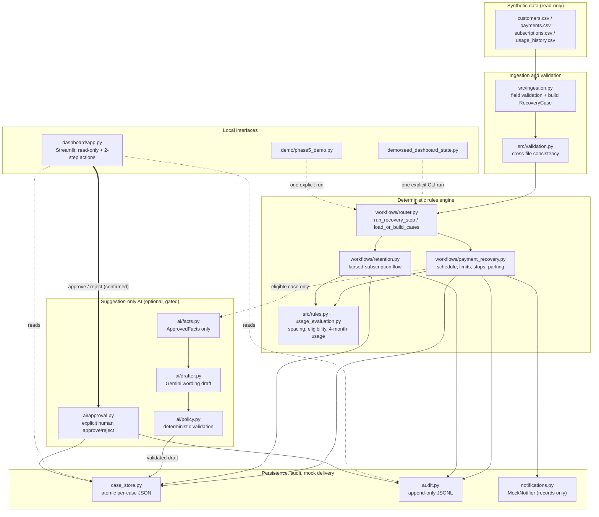
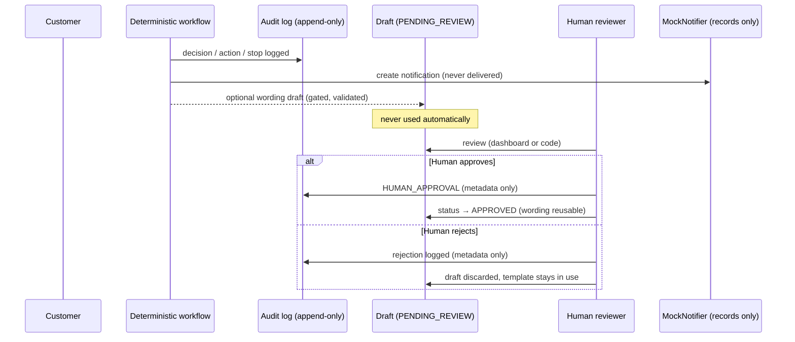

# AI Revenue Recovery Agent

A beginner-friendly, reliability-focused agent that handles **failed
payments** and **lapsed subscriptions** with deterministic rules, an
**append-only audit log**, **mock-only notifications**, and
**suggestion-only AI drafting that always waits for human approval**.

> **Problem statement.** Subscription businesses lose revenue when
> payments fail and when customers drift away from lapsed plans, but
> clumsy automation (auto-retries, surprise charges, unreviewed AI
> messages) damages trust. This project shows a safer pattern:
> ordinary Python code owns every business rule and every action,
> while an LLM may only propose *wording* — which a human must
> explicitly approve before it can ever be used.

**This is a portfolio-ready prototype.** Everything runs locally on
synthetic data: notifications are recorded but never delivered,
payments are never processed, and no AI call happens unless you
configure one yourself.

## Safety rules (apply to every phase)

- The agent NEVER automatically retries, charges, debits, or
  processes a payment. The customer always completes payment
  manually.
- Unspecified business rules are marked `NOT_YET_SPECIFIED` in
  `src/business_rules.py` and must never be treated as approved.
- The four original CSVs are opened read-only and are never modified.
- Notifications are MOCK ONLY (`MockNotifier` records them; nothing
  is sent).
- AI drafts wording only. Deterministic code controls business rules,
  eligibility, scheduling, limits, stop conditions, and actions.
- Every AI draft is stored as `PENDING_REVIEW` and is used only after
  a human explicitly approves it.

## Features

- **Payment recovery (insufficient funds):** up to three reminders,
  two calendar days apart, anchored on the expected payday
  (payday, payday+2, payday+4). Never sent early.
- **Bank / payment-processor errors:** exactly one reminder.
- **Stop conditions** enforced by ordinary Python: payment succeeds,
  customer opts out, notification limit reached, case closed.
- **Month boundaries pause** — no automatic rollover (rollover rule
  is `NOT_YET_SPECIFIED`).
- **Stale reminders park** — a reminder whose date passed unprocessed
  is never sent late, never rescheduled, and counts are never reset.
- **Subscription retention:** lapsed subscription with consistently
  high usage over the four most recent months → ask the customer.
  Low / mixed / missing / ambiguous usage → `NOT_YET_SPECIFIED`.
- **Persistent state:** one atomic JSON file per case; corrupted or
  invalid state raises an error instead of silently resetting.
- **Append-only audit:** every decision, action, state transition,
  customer input, and stop condition as one JSON line.
- **Suggestion-only AI (optional):** Gemini drafts message wording
  from a fixed set of approved facts; deterministic validation
  rejects URLs, invented amounts, offers, and retry/charge promises;
  humans approve or reject each draft.
- **Local Streamlit dashboard:** read-only views plus two explicit,
  two-step-confirmed human actions (approve / reject a draft).
- **Self-checking synthetic demo:** end-to-end scenario with hard
  assertions that exits non-zero if any safety property fails.

## Architecture



Key rule visible in the diagram: **workflows run only from explicit
code paths** (tests, demo, seeder). The dashboard only *reads* state
and can only approve/reject drafts through `src/ai/approval.py`.

### Component map

| Area | Files | Responsibility |
|---|---|---|
| Data model | `src/models.py` | records, workflow states, draft records |
| Business rules | `src/business_rules.py`, `src/rules.py`, `src/usage_evaluation.py` | every confirmed rule; unresolved ones say `NOT_YET_SPECIFIED` |
| Ingestion | `src/ingestion.py`, `src/validation.py` | CSV loading, field and cross-file checks |
| Workflows | `src/workflows/{payment_recovery,retention,router}.py` | the two independent workflows + persistence hook |
| State | `src/case_store.py` | atomic per-case JSON, schema-checked |
| Audit | `src/audit.py` | append-only JSON-lines log |
| Notifications | `src/notifications.py` | `MockNotifier` (records, never sends) |
| AI | `src/ai/{facts,drafter,policy,approval}.py` | approved facts → draft → validation → human approval |
| Dashboard | `dashboard/{app,data,actions,config}.py` | local read-only UI + two confirmed actions |
| Demos | `demo/phase5_demo.py`, `demo/seed_dashboard_state.py` | self-checking e2e demo, dashboard state seeder |

## Technology stack

- **Language:** Python (developed and tested on Python 3.14)
- **UI:** Streamlit (local only)
- **AI (optional):** official `google-genai` SDK — lazily imported,
  gated behind two environment flags
- **Testing:** pytest (including `streamlit.testing.v1.AppTest` for
  the dashboard)
- **Storage:** plain JSON files (atomic writes) + JSON-lines audit
  log — no database, no server

## Prerequisites and setup (Windows)

- Python 3.10 or newer (developed on 3.14). Check with `python --version`.
- This repository folder.

Open **PowerShell** in the project folder:

```powershell
# 1. Optional but recommended: a virtual environment
python -m venv .venv
.venv\Scripts\Activate.ps1

# If activation is blocked by execution policy, run first:
Set-ExecutionPolicy -Scope Process RemoteSigned

# 2. Install dependencies
python -m pip install --upgrade pip
python -m pip install -r requirements.txt

# 3. Run the test suite (no key, no network needed)
python -m pytest -q
```

Dependencies: `pytest`, `streamlit`, `google-genai` (the SDK is only
used if you deliberately enable live drafting).

## Running the tests

```powershell
# Full suite (live API test is skipped automatically without a key)
python -m pytest

# Explicitly exclude the live marker
python -m pytest -m "not live"

# Dashboard tests only
python -m pytest tests/test_dashboard_data.py tests/test_dashboard_actions.py tests/test_dashboard_app.py -v

# Legacy root-level tests (still supported)
python -m pytest test_phase1.py test_phase2.py
```

The suite covers: ingestion and cross-file validation; every
recovery/retention rule (limits, spacing, stop conditions, parking,
month boundaries); persistence and restart safety; corrupt-state
failure; AI validation, fallback, and approval flows; duplicate and
stale human actions; audit privacy; dashboard read-only behavior; and
guardrails proving there is no payment/SMS/network code in `src/`.

## Running the synthetic end-to-end demo

```powershell
python demo/phase5_demo.py
```

The demo runs a full scenario with a **fake** Gemini client and
temporary directories, with hard assertions in nine "acts" (rules,
drafting, approval, persistence, audit privacy, file safety). It exits
non-zero if any safety property fails, and it deletes its temporary
artifacts on exit. No network, no SMS, no payment operations.

## Local dashboard (seed + launch)

```powershell
# 1. Seed synthetic demo state (refuses to overwrite existing state!)
python demo/seed_dashboard_state.py

# Only if you deliberately want to replace existing demo state:
python demo/seed_dashboard_state.py --reset-existing

# 2. Launch the local dashboard
streamlit run dashboard/app.py
```

- The UI is labelled **DEMO MODE — SYNTHETIC DATA ONLY**.
- Sections: Overview, Cases, Drafts (approve/reject), Audit.
- Approve/Reject always requires a **second confirmation click**;
  duplicate or stale confirmations are refused with a clear error.
- Rendering is read-only: opening or rerunning the app never runs a
  workflow and never modifies state or audit files.
- Bound to `localhost` via `.streamlit/config.toml`; telemetry off.
- Corrupt or missing state shows a clear error or notice — it is
  never silently reset or fabricated.

## Gemini configuration (optional)

AI drafting is **suggestion-only** and off by default. It runs only
when **both** values are set:

```powershell
set GEMINI_API_KEY=your-key-here        # never commit this value
set AI_DRAFTING_ENABLED=true
set GEMINI_MODEL=gemini-3.5-flash-lite  # optional (default)
```

- See `.env.example` for the full list of variables. The project has
  **no dotenv dependency**: copy the values into your shell or IDE
  run configuration instead of expecting a `.env` file to auto-load.
- Default model: `gemini-3.5-flash-lite` (verified against the
  official Gemini model list; `gemini-2.0-flash` was shut down on
  2026-06-01 and must not be used).
- Without both values, deterministic templates are used — the whole
  suite runs the same either way.
- Drafts are validated (`max 320` chars, no URLs, no discounts or
  offers, no auto-retry/auto-charge promises, only the approved
  amount) and then wait in `PENDING_REVIEW` for a human.
- The audit log records drafting **metadata only**: never the API
  key, never the full draft text, never customer names.
- The single live smoke test is marked `live` and only runs when you
  ask for it: `python -m pytest -m live -v tests/test_live_api_smoke.py`.

## Safety controls and human approval workflow



| Control | Enforced by |
|---|---|
| No auto-charge / auto-debit / retry | guardrail tests forbid such functions; templates contain no links or promises |
| No real SMS | `MockNotifier` exposes only `create`/`created`/`count`; no SMS library in `requirements.txt` |
| No network code in `src/` | guardrail test: no HTTP/socket/mail imports except the gated lazy AI SDK import |
| AI never acts | drafts stored `PENDING_REVIEW`; workflows use approved wording or the template |
| Human approval required | `src/ai/approval.py` is the only promotion path; duplicates and stale actions are refused |
| Audit privacy | metadata only; tests assert no key, draft text, message text, or customer name |
| Counts never reset | corrupt/invalid state raises `CaseStoreError` instead of resetting |
| CSV integrity | SHA-256 checks in the demo/seed paths; original CSVs never written |

## What each phase adds

- **Phase 1 — data foundation:** CSV loading with field validation,
  cross-file consistency checks, one `RecoveryCase` per customer
  (all payments and subscriptions kept).
- **Phase 2 — deterministic rules engine:** the two independent
  workflows, scheduling, limits, stop conditions, mock notifications,
  append-only audit.
- **Phase 3 — reliability preparation:** persistent per-case state,
  restart-safe resumption, two-calendar-day send spacing, stale
  reminder parking, idempotent stop-condition logging.
- **Phase 4 — suggestion-only AI drafting:** approved-facts-only
  prompts, deterministic validation backstop, explicit human
  approval, metadata-only audit.
- **Phase 5 — synthetic end-to-end demo:** self-checking scenario
  with hard assertions (fake client, temp dirs only).
- **Phase 6 — local dashboard:** read-only Streamlit UI with
  two-step confirmed approve/reject actions and overwrite-protected
  seeding.
- **Phase 7 — reliability and integration preparation:** focused
  regression tests closing the remaining gaps (duplicate/stale human
  actions at source level, mixed/ambiguous retention usage, network
  import guardrail, no-SDK-import guard).
- **Phase 8 — portfolio and GitHub preparation:** documentation,
  `.gitignore`, `.env.example`, repository hygiene.

## NOT_YET_SPECIFIED (needs a business decision)

- Month rollover behaviour (scheduling pauses instead)
- Phone-number source (CRM integration)
- What to do for lapsed subscriptions with low/mixed/no usage
- What to do with stale (overdue, unprocessed) reminders
- Real SMS delivery
- Re-importing CSV changes into already-saved cases
- Human review workflow for AI drafts (approval is a separate,
  explicit code step; who reviews and when is a business process)

## Current limitations

- **Prototype, not production:** no deployment, no authentication,
  no monitoring, single-user local use only.
- Data is **synthetic**; notifications are **mock** (nothing is ever
  sent) and payments are **never processed**.
- `NOT_YET_SPECIFIED` cases deliberately do nothing until a rule is
  defined — parked cases are visible in state, audit, and dashboard.
- No database: one JSON file per case, fine for this dataset scale.
- No automated CI pipeline yet (tests are run locally).
- The audit log grows forever (append-only by design; no rotation).

## Future improvements

- Decide the `NOT_YET_SPECIFIED` policies (rollover, stale reminders,
  mixed-usage retention) before any real integration.
- A vetted SMS provider behind the same mock interface, only after a
  phone-number source policy exists.
- CI (run `pytest -m "not live"` on every push) and coverage
  reporting.
- Auth + HTTPS + hosting review if the dashboard is ever shared.
- Draft-review queue UX (assignee, notes) on top of the existing
  approve/reject API.

## Deliberately NOT implemented

Payment processing, automatic retries, real SMS, CRM integration,
Firebase. AI never acts on its own: it only proposes message wording,
and only humans can approve it.
